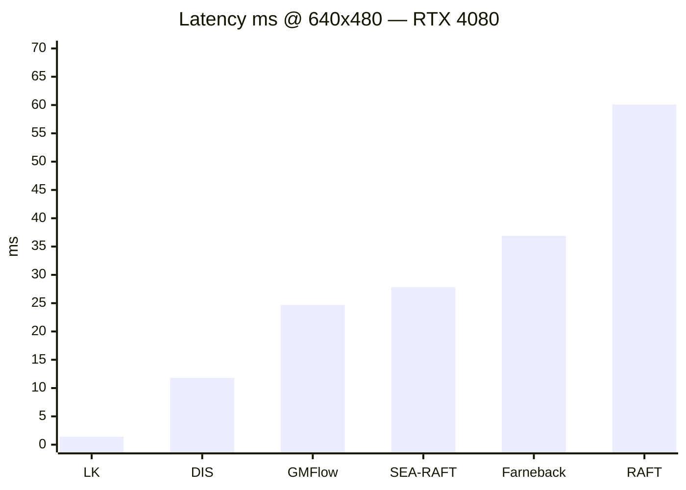
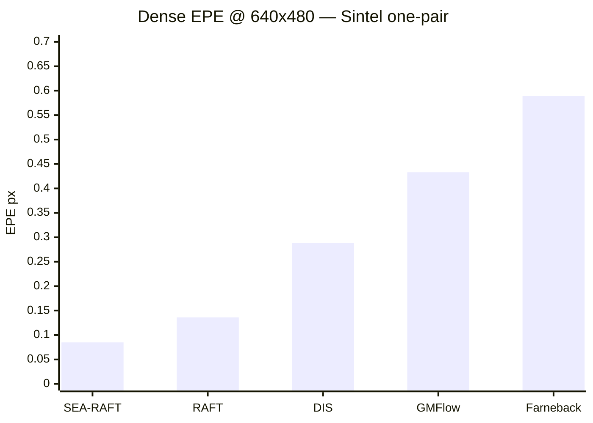
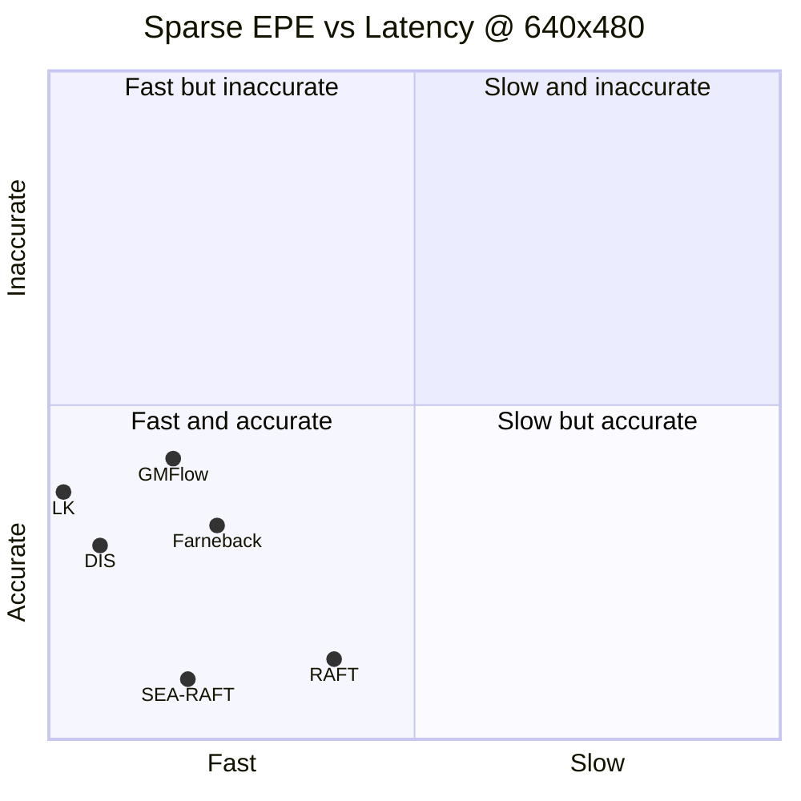

# Нейросетевая аппроксимация Basalt SE2 optical flow (ВАК)

Исследовательский каркас: единое сравнение классики / нейросетей / Basalt SE2, методика обучения и бенчмарк.

**Eval-машина (T2):** Windows 10, NVIDIA GeForce RTX 4080, CUDA 12.4 (`torch 2.6.0+cu124`). Код и прогоны baselines — на этой машине; RK3588 — отдельно на этапе T5.

## Цель

Teacher: **Basalt SE2** sparse optical flow (качество высокое, медленный).  
Student: компактная NN → качество ≈ Basalt, **≥20 FPS на RK3588**.

Документы:

| Файл | Содержание |
|------|------------|
| [docs/01-survey-comparison.md](docs/01-survey-comparison.md) | Обзор и единая таблица сравнения |
| [docs/02-eval-protocol.md](docs/02-eval-protocol.md) | Протокол метрик и датасетов |
| [docs/03-training-methodology.md](docs/03-training-methodology.md) | Методика обучения NN + distillation |

## Структура

```text
research/basalt-optical-flow-nn/
  configs/default.yaml
  docs/
  src/
    compare.py          # entrypoint → results/*.csv
    metrics.py
    runners/            # LK, Farneback, RAFT, stubs SEA-RAFT/…/Basalt
  data/                 # датасеты (не в git)
  weights/              # pretrained (не в git)
  third_party/RAFT/     # clone princeton-vl/RAFT (не в git)
  results/              # CSV/MD после прогона (не в git)
```

## Установка (Windows + CUDA)

```powershell
cd research/basalt-optical-flow-nn
python -m venv .venv
.\.venv\Scripts\Activate.ps1
pip install -r requirements.txt
pip install torch torchvision --index-url https://download.pytorch.org/whl/cu124
```

Проверка: `python -c "import torch; print(torch.cuda.is_available())"` → `True`.

### RAFT (T2)

```powershell
git clone --depth 1 https://github.com/princeton-vl/RAFT.git third_party\RAFT
# weights: https://dl.dropboxusercontent.com/s/4j4z58wuv8o0mfz/models.zip
# → weights/raft-sintel.pth
```

Системные зависимости: OpenCV из pip; для Basalt — сборка C++ (ниже).

## Датасеты

Положите под `data/` (или поправьте пути в `configs/default.yaml`):

**Sintel** — [MPI Sintel](http://sintel.is.tue.mpg.de/):  
`data/sintel/training/{clean,final,flow}/...`  
(архив `MPI-Sintel-complete.zip` → распаковать в `data/sintel/`)

**KITTI 2015** — [KITTI flow](https://www.cvlibs.net/datasets/kitti/eval_scene_flow.php?benchmark=flow):  
`data/kitti2015/...` (в `default.yaml` пока `enabled: false`)

**EuRoC** (teacher, опционально на T3): `data/euroc/...`

## Быстрый прогон

Список методов:

```powershell
python -m src.compare --list-methods
```

Smoke-тест без датасетов (синтетический сдвиг; LK + Farneback + RAFT):

```powershell
python -m src.compare --synthetic
```

Если Sintel лежит в `data/sintel`:

```powershell
python -m src.compare --config configs/default.yaml
```

Пара кадров вручную:

```powershell
python -m src.compare --pair /path/a.png /path/b.png --flow-gt /path/gt.flo
```

Результаты: `results/comparison.csv`, `results/comparison.md`.

В `configs/default.yaml` по умолчанию включены `opencv_lk`, `opencv_farneback`, `raft` (weights `weights/raft-sintel.pth`). Остальные NN / Basalt — stubs (`enabled: false`).

## Статус T2 (этот ПК)

Прогон на MPI Sintel (первая training/clean пара, resize + общий sparse protocol), **RTX 4080**, CUDA 12.4.  
**7 методов:** LK, Farneback, DIS, RAFT, SEA-RAFT, GMFlow, **Basalt SE2**.  
Latency = mean 50 frames после warmup 5.

**Basalt SE2:** официальный бинарь `basalt_opt_flow` живёт в Docker-образе `basalt-of:local` (EuRoC/T3), но не умеет пару кадров→NPZ. Для sparse protocol подключён **тот же SE2 IC / Pattern51 алгоритм** из open headers Basalt (`backend: native` для latency; `backend: docker` — тот же код в контейнере).  
Не подняты: **FlowFormer / LiteFlowNet / FastFlowNet** (stubs).

### Latency @ 640×480 (ниже = быстрее; Basalt SE2 ~3.3s — Python ref)



### Dense EPE @ 640×480 (ниже = лучше)



### Pareto: sparse EPE vs latency (640×480)



Координаты: X ≈ latency / 150, Y ≈ sparse EPE (нормировка для картинки).

### Таблица

| Method | Res | Dense EPE | Sparse EPE | Success | Latency ms | ≈FPS |
|--------|-----|-----------|------------|---------|------------|------|
| opencv_lk | 640×480 | — | 0.37 | 100% | **1.3** | ~740 |
| opencv_dis | 640×480 | 0.29 | 0.29 | 100% | **11.8** | ~85 |
| gmflow | 640×480 | 0.43 | 0.42 | 100% | **24.7** | ~40 |
| sea_raft | 640×480 | **0.085** | **0.087** | 100% | **27.8** | ~36 |
| opencv_farneback | 640×480 | 0.59 | 0.32 | 100% | 36.9 | ~27 |
| raft | 640×480 | 0.14 | 0.12 | 100% | 60.1 | ~17 |
| basalt_se2 | 640×480 | — | **0.28** | 78% | ~3300 | ~0.3 |
| opencv_lk | 1280×720 | — | 0.48 | 100% | **2.2** | ~460 |
| opencv_dis | 1280×720 | 0.34 | 0.42 | 100% | **26.6** | ~38 |
| sea_raft | 1280×720 | **0.084** | **0.12** | 100% | **90.1** | ~11 |
| opencv_farneback | 1280×720 | 1.44 | 0.46 | 100% | 114 | ~9 |
| raft | 1280×720 | 0.13 | 0.14 | 100% | 128 | ~8 |
| gmflow | 1280×720 | 1.01 | 1.12 | 100% | 144 | ~7 |
| basalt_se2 | 1280×720 | — | 0.44 | 81% | ~3480 | ~0.3 |

На 480p лучший NN accuracy–speed: **SEA-RAFT**. Teacher **Basalt SE2** — sparse EPE ~0.28 (лучше LK), но текущая Python-реализация медленная (цель T5 — RKNN student ≥20 FPS).

### Docker Basalt

```powershell
docker build -t basalt-of:local docker/basalt_of
docker run --rm basalt-of:local basalt_opt_flow --help   # official binary
# pair track (same SE2 algo):
# docker run --rm -v ${PWD}/tmp:/data basalt-of:local python3 /opt/basalt_of/track_pair.py ...
```

В YAML: `basalt_se2.backend: docker` чтобы гонять pair-track в контейнере (для latency оставляйте `native`).

Это **one-pair protocol** (`compare.py`), не полный Sintel leaderboard. Сырые CSV: `results/comparison.csv`. Обзор — `docs/01-survey-comparison.md`.

## Подключение остальных (stubs)

FlowFormer / LiteFlowNet / FastFlowNet: клон upstream + веса + runner по образцу `src/runners/raft.py` / `sea_raft.py`.  
Пока stub → `status=not_implemented` в CSV.

## Basalt SE2 (teacher)

Официальный [Basalt](https://gitlab.com/VladyslavUsenko/basalt) ставится в Docker (`docker/basalt_of`). `basalt_opt_flow` рассчитан на EuRoC-датасет, не на пару PNG.

Для бенчмарка sparse protocol: runner `basalt_se2` (Pattern51 + SE2 IC из open headers). По умолчанию `backend: native`; для прогона в контейнере — `backend: docker` + образ `basalt-of:local`.

## RK3588 (этап T5, не T1/T2)

После обучения student: экспорт ONNX → RKNN Toolkit 2 → замер FPS тем же протоколом разрешения. Цель: **≥20 FPS**. Python-каркас здесь только для сравнения; прод-инференс на плате обычно C++/RKNN runtime.

## Этапы

| Этап | Статус |
|------|--------|
| T1 Обзор + протокол + каркас бенчмарка | каталог готов |
| T2 Прогон baselines на GPU | **сделано** (LK / Farneback / DIS / RAFT / SEA-RAFT / GMFlow / Basalt SE2 на Sintel; Docker `basalt-of:local`) |
| T3 Basalt teacher / labels | |
| T4 Обучение student + distillation | |
| T5 RK3588 ≥20 FPS | |
| T6 Черновик статьи ВАК | |

## Цитирование идей (не полный список)

Basalt (Usenko et al.); RAFT; SEA-RAFT; GMFlow; FlowFormer; PWC-Net; LiteFlowNet; FastFlowNet — см. `docs/01-survey-comparison.md`.
