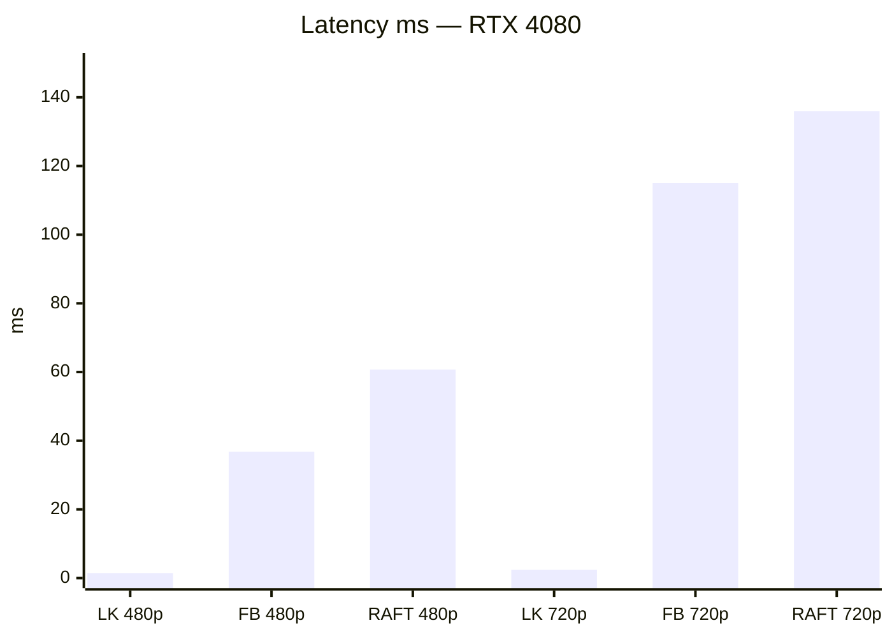
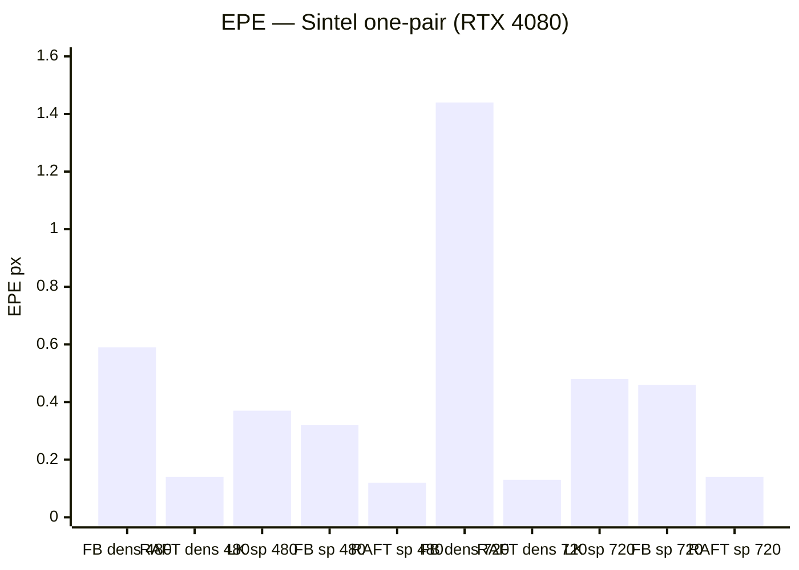
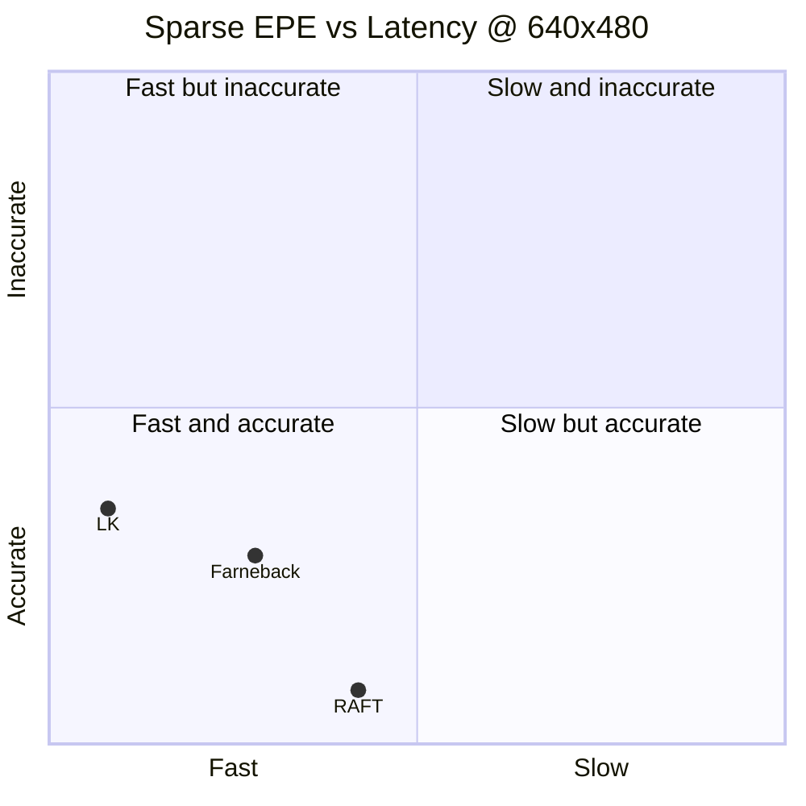

# Нейросетевая аппроксимация Basalt SE2 optical flow (ВАК)

Исследовательский каркас: единое сравнение классики / нейросетей / Basalt SE2, методика обучения и бенчмарк.

**Eval-машина (T2):** Windows 10, NVIDIA GeForce RTX 4080, CUDA 12.4 (`torch 2.6.0+cu124`). Код и прогоны baselines — на этой машине; RK3588 — отдельно на этапе T5.

## Цель

Teacher: **Basalt SE2** sparse optical flow (качество высокое, медленный).  
Student: компактная NN → качество ≈ Basalt, **≥20 FPS на RK3588**.

Документы:

| Файл | Содержание |
|------|------------|
| [docs/01-survey-comparison.md](docs/01-survey-comparison.md) | Обзор и единая таблица сравнения |
| [docs/02-eval-protocol.md](docs/02-eval-protocol.md) | Протокол метрик и датасетов |
| [docs/03-training-methodology.md](docs/03-training-methodology.md) | Методика обучения NN + distillation |

## Структура

```text
research/basalt-optical-flow-nn/
  configs/default.yaml
  docs/
  src/
    compare.py          # entrypoint → results/*.csv
    metrics.py
    runners/            # LK, Farneback, RAFT, stubs SEA-RAFT/…/Basalt
  data/                 # датасеты (не в git)
  weights/              # pretrained (не в git)
  third_party/RAFT/     # clone princeton-vl/RAFT (не в git)
  results/              # CSV/MD после прогона (не в git)
```

## Установка (Windows + CUDA)

```powershell
cd research/basalt-optical-flow-nn
python -m venv .venv
.\.venv\Scripts\Activate.ps1
pip install -r requirements.txt
pip install torch torchvision --index-url https://download.pytorch.org/whl/cu124
```

Проверка: `python -c "import torch; print(torch.cuda.is_available())"` → `True`.

### RAFT (T2)

```powershell
git clone --depth 1 https://github.com/princeton-vl/RAFT.git third_party\RAFT
# weights: https://dl.dropboxusercontent.com/s/4j4z58wuv8o0mfz/models.zip
# → weights/raft-sintel.pth
```

Системные зависимости: OpenCV из pip; для Basalt — сборка C++ (ниже).

## Датасеты

Положите под `data/` (или поправьте пути в `configs/default.yaml`):

**Sintel** — [MPI Sintel](http://sintel.is.tue.mpg.de/):  
`data/sintel/training/{clean,final,flow}/...`  
(архив `MPI-Sintel-complete.zip` → распаковать в `data/sintel/`)

**KITTI 2015** — [KITTI flow](https://www.cvlibs.net/datasets/kitti/eval_scene_flow.php?benchmark=flow):  
`data/kitti2015/...` (в `default.yaml` пока `enabled: false`)

**EuRoC** (teacher, опционально на T3): `data/euroc/...`

## Быстрый прогон

Список методов:

```powershell
python -m src.compare --list-methods
```

Smoke-тест без датасетов (синтетический сдвиг; LK + Farneback + RAFT):

```powershell
python -m src.compare --synthetic
```

Если Sintel лежит в `data/sintel`:

```powershell
python -m src.compare --config configs/default.yaml
```

Пара кадров вручную:

```powershell
python -m src.compare --pair /path/a.png /path/b.png --flow-gt /path/gt.flo
```

Результаты: `results/comparison.csv`, `results/comparison.md`.

В `configs/default.yaml` по умолчанию включены `opencv_lk`, `opencv_farneback`, `raft` (weights `weights/raft-sintel.pth`). Остальные NN / Basalt — stubs (`enabled: false`).

## Статус T2 (этот ПК)

Прогон на MPI Sintel (первая training/clean пара, resize + общий sparse protocol), **RTX 4080**, CUDA 12.4.  
Latency = mean 50 frames после warmup 5. RAFT: `raft-sintel.pth`, iters=20.

### Latency (ниже = быстрее)



### Качество: Dense EPE и Sparse endpoint EPE (ниже = лучше)



### Pareto: качество vs скорость (640×480)



Координаты на Pareto: X ≈ latency / 150, Y ≈ sparse EPE / 1.0 (нормировка только для картинки).

### Таблица

| Method | Res | Dense EPE | Sparse EPE | Latency ms | ≈FPS |
|--------|-----|-----------|------------|------------|------|
| opencv_lk | 640×480 | — | 0.37 | 1.4 | ~710 |
| opencv_farneback | 640×480 | 0.59 | 0.32 | 36.8 | ~27 |
| raft | 640×480 | **0.14** | **0.12** | 60.7 | ~16 |
| opencv_lk | 1280×720 | — | 0.48 | 2.4 | ~420 |
| opencv_farneback | 1280×720 | 1.44 | 0.46 | 115.1 | ~9 |
| raft | 1280×720 | **0.13** | **0.14** | 136.0 | ~7 |

Это **one-pair protocol** каркаса (`compare.py`), не полный Sintel leaderboard. Сырые CSV: `results/comparison.csv`. Обзорная таблица — в `docs/01-survey-comparison.md`.

## Подключение других нейросетей

1. Клонировать официальный репозиторий (SEA-RAFT / GMFlow / …).
2. Скачать pretrained weights.
3. В YAML: `methods[].enabled: true`, указать `weights` и `device: cuda`.
4. Реализовать runner по образцу `src/runners/raft.py` — интерфейс `predict(img1, img2) -> FlowResult` с `flow_dense` HxWx2.

Пока stub поднимает `NotImplementedError` → в CSV строка `status=not_implemented`.

## Basalt SE2 (teacher)

1. Собрать [Basalt](https://gitlab.com/VladyslavUsenko/basalt) на Linux (зависимости: Eigen, Sophus, OpenCV, TBB и т.д. — см. upstream README).
2. Написать тонкий CLI или pybind: пара кадров (+ keypoints) → `points1`, `points2`, `status`, опционально `se2_params`.
3. В YAML:

```yaml
  - id: basalt_se2
    enabled: true
    kind: sparse_se2
    binary: /path/to/basalt_of_cli
    config: /path/to/basalt_config.json
```

4. Дописать I/O в `src/runners/basalt_stub.py` (сейчас — контракт и заглушка).

## RK3588 (этап T5, не T1/T2)

После обучения student: экспорт ONNX → RKNN Toolkit 2 → замер FPS тем же протоколом разрешения. Цель: **≥20 FPS**. Python-каркас здесь только для сравнения; прод-инференс на плате обычно C++/RKNN runtime.

## Этапы

| Этап | Статус |
|------|--------|
| T1 Обзор + протокол + каркас бенчмарка | каталог готов |
| T2 Прогон baselines на GPU | **сделано** (LK / Farneback / RAFT на Sintel, RTX 4080) |
| T3 Basalt teacher / labels | |
| T4 Обучение student + distillation | |
| T5 RK3588 ≥20 FPS | |
| T6 Черновик статьи ВАК | |

## Цитирование идей (не полный список)

Basalt (Usenko et al.); RAFT; SEA-RAFT; GMFlow; FlowFormer; PWC-Net; LiteFlowNet; FastFlowNet — см. `docs/01-survey-comparison.md`.
